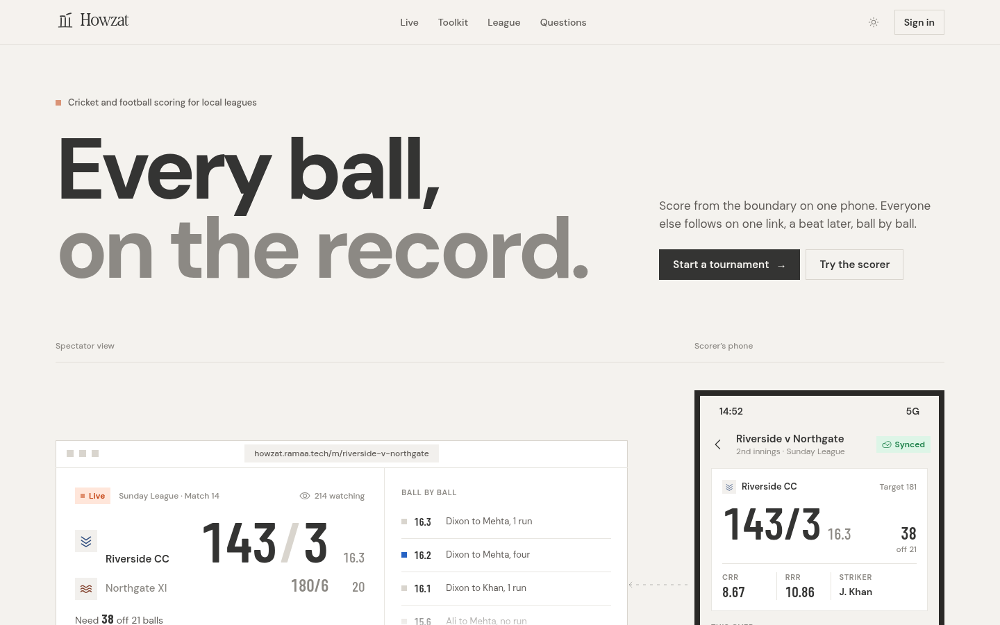
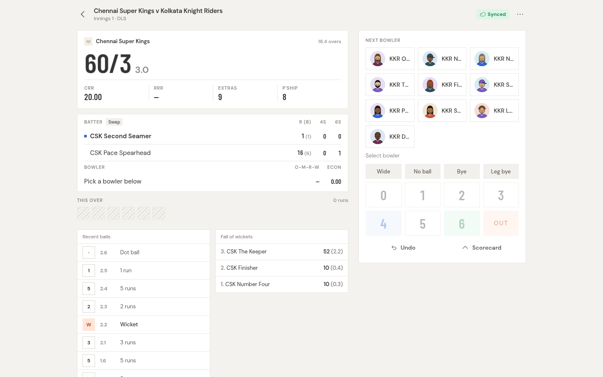
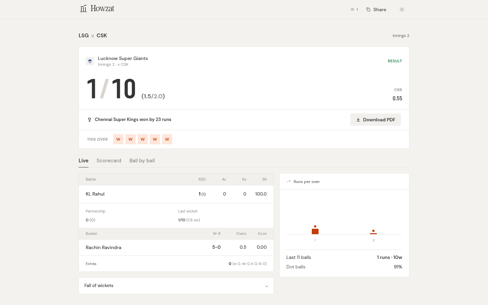
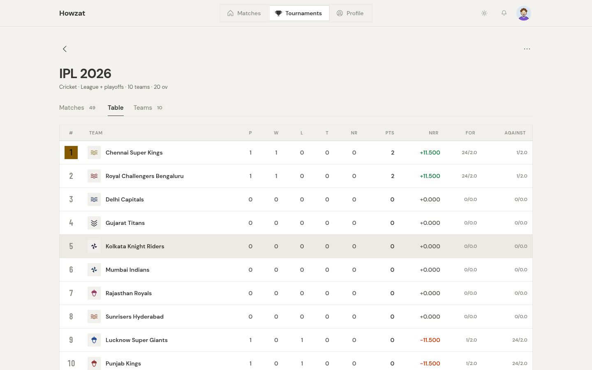
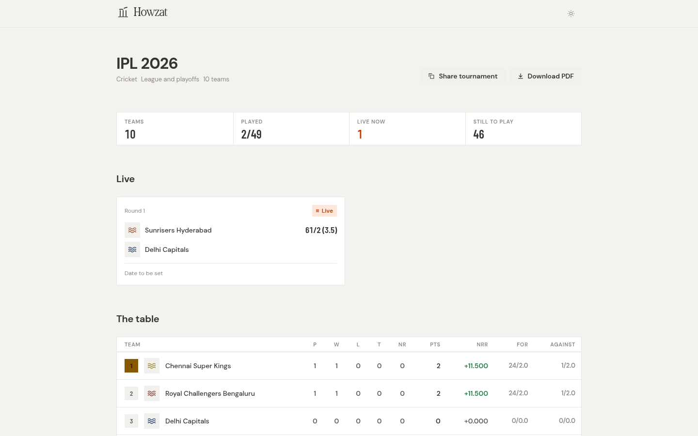
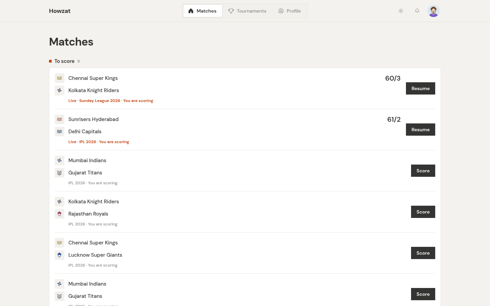
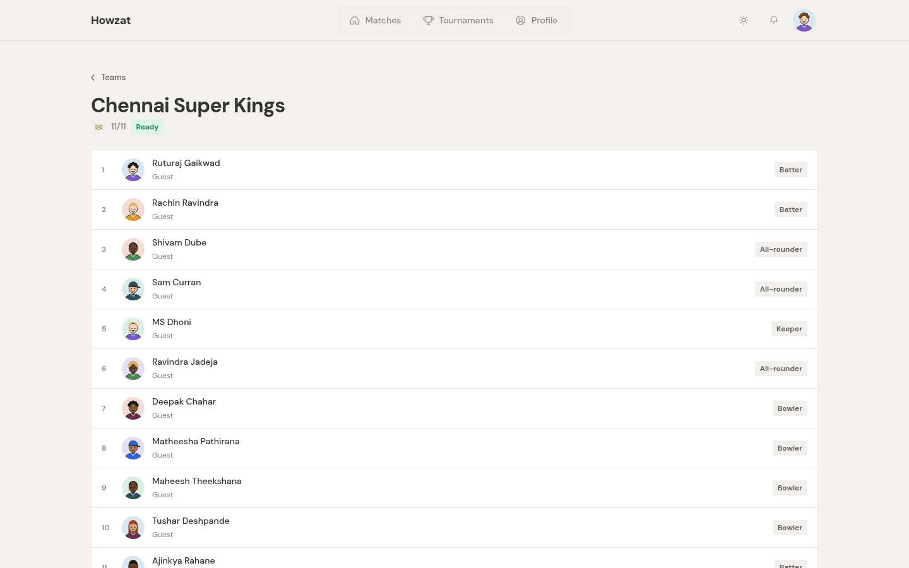
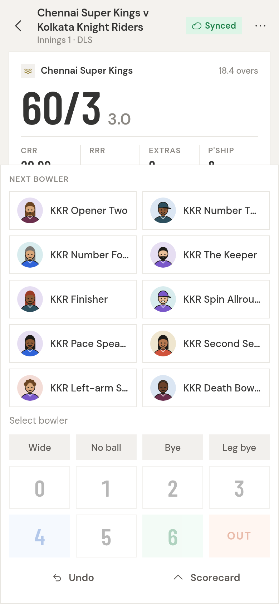
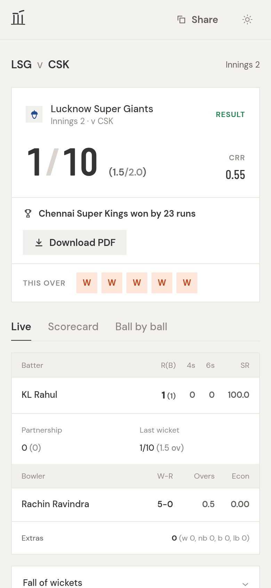
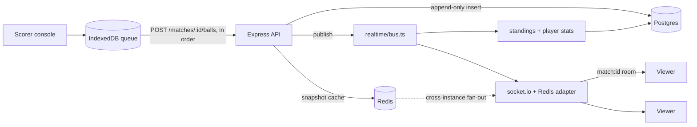

<div align="center">

# Howzat

**Cricket and football scoring for local leagues. One phone scores, everyone else follows a link.**

[](https://howzat.ramaa.tech)


</div>

<div align="center">
  
</div>

---

## Why it exists

Club and street cricket gets scored on paper, in a WhatsApp group, or not at
all. The people who want the score are a parent, a teammate on the way to the
ground, or the player who went home after the toss. None of them will install
an app or make an account to see it.

Howzat gives one person a scoring console and everybody else a URL.

- **The scorer** taps each ball or incident. Every tap is an append-only event,
  and the console keeps working when the signal at the ground drops.
- **Spectators** open the share link. The score arrives over a websocket with
  no login.
- **The organizer** gets fixtures, a playoff bracket, and a points table that
  rebuilds itself after every result, plus what each side still needs to
  qualify.
- **Players** go onto a team sheet in one flow, with or without an account. A
  registered player gets a career profile that fills in as matches finish.

Football runs on the same model. The scorer records goals, cards and
substitutions against a match clock, and the league table follows the same
recompute-from-events rule as cricket.

---

## Screenshots

<table>
<tr>
<td width="50%">

<p align="center"><strong>Scoring console</strong><br><sub>One tap per ball. At the end of an over the console asks for the next bowler with player tiles, and Undo sits under the pad.</sub></p>
</td>
<td width="50%">

<p align="center"><strong>Public share link</strong><br><sub>No account and no install. A viewer who joins mid-match sees the current score straight away.</sub></p>
</td>
</tr>
<tr>
<td width="50%">

<p align="center"><strong>Points table</strong><br><sub>Rebuilt from the innings records on every result. The runs and overs behind each NRR figure sit next to it.</sub></p>
</td>
<td width="50%">

<p align="center"><strong>Public tournament page</strong><br><sub>One link for the whole league, with live matches, the table and a PDF export.</sub></p>
</td>
</tr>
<tr>
<td width="50%">

<p align="center"><strong>Scorer's dashboard</strong><br><sub>Every match you are assigned to, live ones first, one button to resume.</sub></p>
</td>
<td width="50%">

<p align="center"><strong>Squads</strong><br><sub>Fixture generation waits until every squad is full, and the page says what is missing.</sub></p>
</td>
</tr>
</table>

<div align="center">

&nbsp;

<p><sub>The console and the share link are built for a phone first.</sub></p>
</div>

---

## How it works



**Scoring goes over HTTP, never the websocket.** Auth, idempotency, validation
and retries live in one place. The realtime layer only fans out reads, and the
write path publishes to `realtime/bus.ts` without importing socket.io.

**Every ball goes through the queue, online or not.** There is no separate
offline path to keep in step. The connection only decides whether the queue
drains now or later, and `clientEventId` makes a replay look the same as a
first attempt.

**Postgres holds the truth and Redis holds a cache.** `BallEvent` is
append-only and is the only record of what happened in a match. Delete the
Redis snapshot and the next read rebuilds the score by folding the event log.
Snapshots carry a match revision, so a slow write cannot overwrite a newer
score.

**Broadcasts carry the whole snapshot, not a delta.** The message is a little
larger. In return, a client that misses one message is corrected by the next,
and a viewer who joins mid-match sees the current score instead of a replay
from ball one.

[docs/storage-and-recovery.md](docs/storage-and-recovery.md) covers
transactions, locks, derived-data retries, backups and offline recovery in
more depth.

---

## Engineering notes

<details open>
<summary><strong>Correctness</strong></summary>

- **Overs are base-6.** `16.5 + 0.1` is `17.0`, not `16.6`. `PointsTable`
  stores balls and converts only when it reads, which keeps the NRR arithmetic
  honest.
- **The bowled-out rule.** A side dismissed inside its quota is charged the
  full quota of overs for NRR, not the balls it faced. A regression test
  proves the rule changes the answer.
- **DLS is derived, never stored.** The scorer records stoppages: overs left,
  wickets down, and overs left on resumption. The allotments, par score and
  revised target are recomputed from that list every time it changes. Delete
  a mistyped stoppage and the match returns to where it would have been. The
  resource table is the ICC Standard Edition. The Professional Edition is a
  licensed program, and the playing conditions fall back to the Standard
  Edition when the program is not at the ground.
- **A DLS result changes NRR too.** Per the ICC rule, the side batting first
  is deemed to have scored the par score off the chasing side's overs.
- **The points table is recomputed, never incremented.** Every
  `match:completed` rebuilds the tournament from the event log in one
  transaction. That costs more than an increment and makes replays safe,
  because a repeated event converges instead of counting twice.
- **Ball writes are idempotent.** Each ball carries a `clientEventId`.
  Re-posting the same body returns `200` with the same snapshot instead of
  `201`, so a flaky connection cannot count a six twice.
- **Undo is an event, not a delete.** `POST /matches/:id/balls/undo` appends
  an `UNDO`. `GET /matches/:id/events` still shows both.

</details>

<details>
<summary><strong>Scoring with no signal</strong></summary>

A ball scored offline goes into IndexedDB and replays when the network
returns. The scorer sees the score move straight away either way.

- **The queue uses the same idempotency key as the write path.** Each queued
  ball is keyed by its `clientEventId`, so the queue can drain blindly. The
  phone cannot know whether its first attempt landed, and it does not need to.
- **The drain runs in order and stops at the first failure.** Whether ball
  *n+1* is legal depends on ball *n*. The UI shows a rejected ball with the
  server's reason and a retry button.
- **The browser runs the same reducer as the server.** Both import
  `packages/shared`, so the offline score comes from the code that will later
  validate it.
- **The previous over's bowler is carried through the fold.** Without it, the
  console would offer the wrong bowlers at the over boundary offline, and the
  server would reject the ball with `CONSECUTIVE_OVERS` minutes later on sync.
- **One tab drains at a time.** Web Locks pick the owner across tabs, and
  BroadcastChannel keeps every tab's queue indicator current.

</details>

<details>
<summary><strong>Security</strong></summary>

- **Sign up once, then use a handle and password.** The email code confirms
  the address once. Mailing a code at every sign-in fails at a ground with bad
  signal, where the scorer's email is on another device and the match is
  waiting. Passwords use bcrypt at cost 12.
- **Access tokens are 15-minute JWTs held in memory**, never in
  `localStorage`, so an XSS cannot read one. The httpOnly refresh cookie
  survives a reload.
- **Refresh tokens are opaque random strings** stored as SHA-256 hashes and
  rotated on every use. Presenting a revoked token counts as theft and revokes
  the whole session family.
- **Codes are scoped to their purpose.** A code sent to confirm an address
  does not work as a password reset. Codes come from `crypto.randomInt` and
  are stored hashed.
- **No enumeration oracles.** Every code failure returns the same message, a
  login against a missing account still runs a password comparison, and
  handle lookup requires a session.
- **`requireScorerForMatch`** guards every match route, with a 60-second Redis
  cache cleared the moment an assignment changes.
- **Rate limits live in Redis** for code requests and ball writes, with a
  truthful `Retry-After`. The per-IP limit is looser than the per-email one,
  so a shared ground wifi does not lock out a whole team.

</details>

<details>
<summary><strong>Running on serverless</strong></summary>

The API is a long-lived Express server locally and a Vercel Function in
production. That difference forced three choices.

- **Websocket transport only.** Socket.IO starts with HTTP long-polling by
  default, and its handshake sticks to one process. On Vercel the next poll
  can land on another instance and fail with `session ID unknown`. Both ends
  set `transports: ['websocket']`.
- **Viewer counts live in Redis.** The adapter's `fetchSockets()` waits for
  every subscribed instance to answer, and Vercel freezes idle instances. A
  sorted set per match, pruned by join time, does not depend on who is awake.
- **Event subscribers are awaited on completion.** Vercel freezes the instance
  once the response is sent, so a detached standings rebuild would stop
  part-way. `publishMatchEvent` returns a promise. The match-completion path
  awaits it, and the ball path does not.

</details>

---

## Run it locally

### Prerequisites

You need Node 20 or later. Both datastores have free tiers, and neither needs
a local install.

- **Postgres on [Neon](https://neon.tech).** Copy two connection strings. The
  pooled one (its host contains `-pooler`) is `DATABASE_URL`. The direct one
  is `DIRECT_URL`. Prisma migrations cannot run through the pooler.
- **Redis on [Upstash](https://upstash.com).** Copy the `rediss://` URL, with
  two s's for TLS. A plain `redis://` URL connects and then fails with
  `MaxRetriesPerRequestError`.

### Setup

```bash
npm install
cp .env.example .env
```

Fill in `DATABASE_URL`, `DIRECT_URL` and `REDIS_URL`. Generate the two secrets
with:

```bash
node -e "console.log(require('crypto').randomBytes(48).toString('base64'))"
```

Leave `RESEND_API_KEY` blank in development. The API then prints verification
and password-reset codes to its log instead of sending email.

```bash
npm run db:migrate      # the first run asks for a name; "init" is fine
npm run db:seed
npm run dev             # API on :4000, web on :5173
```

### Seeded accounts

Sign in with the handle and password. All three accounts use `howzat1234` and
are seeded as verified.

| Handle | Password | Role |
| --- | --- | --- |
| `@organizer` | `howzat1234` | Owns both tournaments |
| `@whynotramaa` | `howzat1234` | Assigned to every IPL 2026 match |
| `@demoscorer` | `howzat1234` | Assigned to nothing, for testing 403s |

There is no role column. An organizer is someone who owns a tournament, and a
scorer is someone with an assignment for a match. All three are also players
in a Sunday League side, so their career profiles fill in as matches finish.

The seed creates **IPL 2026** with 10 teams, 11 players each and 49 matches,
and **Sunday League 2026** as a 4-team sandbox. It is idempotent and never
regenerates fixtures for a tournament whose matches have started. The squads
are demo data, not real rosters.

---

## Deploy

Web and API ship as one Vercel project on one origin. The SPA is at `/`, the
API at `/api/*`, and sockets at `/api/socket.io`. A single origin keeps the
`sameSite=strict` refresh cookie working and removes CORS.

```bash
npm run db:deploy       # once per release, before the new API serves traffic
npm run build           # API bundle + web static build
npx vercel --prod
```

`vercel.json` builds the API with tsup before Vercel compiles the function.
Vercel transpiles files under `api/` one at a time and does not follow a
relative TypeScript import out of that directory.

> **Note.** On the free plan a function runs for at most 300 seconds, so a
> live-match websocket reconnects at least every five minutes. In a measured
> run the connection held for 315 seconds, closed with `transport close`, and
> reconnected 2 seconds later with the viewer count intact. The client loads
> the snapshot first, so viewers do not notice.

---

## Check it

`npm test` runs Vitest over the shared logic (cricket and football reducers,
fixtures, NRR, DLS, career stats, the football clock and formations), the
offline ball queue, and the API scoring route.

These checks need a person:

| Check | Expected |
| --- | --- |
| Score a wide and a no-ball in an over | After six taps the over reads `0.4`, not `0.6` |
| Re-post a ball with the same `clientEventId` | `200` with the same snapshot, and the score does not move |
| Pick the same bowler two overs running | Rejected with `CONSECUTIVE_OVERS` |
| Run `DEL match:<id>` in Redis, then re-read the snapshot | The same score, rebuilt from the event log |
| Open the share link mid-match in a fresh window | The current score at once, never a replay from ball one |
| Kill the API with the live page open | The badge shows "Reconnecting", then resyncs |
| Score an over offline, then restore the network | The score moves as you tap, the queue drains in order, and the server lands on the same total |
| Run two API instances and score through one | The viewer on the other updates through Redis pub/sub |
| Bowl out a chasing side inside its quota | That row's `oversFaced` is the full quota |

---

## Layout

```
packages/shared/   types, zod schemas, constants: one contract for both apps
  src/scoring/             cricket reducer, legal-state guard, base-6 formatting
  src/football/            football reducer, match clock, formations, standings
  src/fixtures/            round robin by the circle method, playoff bracket
  src/nrr/                 points and NRR, including the bowled-out quota rule
  src/dls/                 ICC Standard Edition table, par and revised targets
  src/qualification/       bounded "can we still qualify" scenarios
  src/stats/career.ts      career totals from per-match rows

apps/api/          express + prisma + redis
  src/app.ts               createApp(), with no listen(), so any host can run it
  src/index.ts             long-lived server entry for local dev
  src/vercel.ts            serverless entry that exports the server
  src/config/env.ts        zod-parsed process.env; throws at boot if incomplete
  src/middleware/          requireAuth, requireScorerForMatch, rate limits
  src/modules/             auth, users, me, notifications, tournaments, teams,
                           players, fixtures, matches, scoring, football, dls,
                           snapshot, standings, stats
  src/modules/public/      the no-auth share link routes, addressed by slug
  src/realtime/bus.ts      the seam the write path publishes to
  src/realtime/io.ts       socket.io + Redis adapter, Redis-backed viewer count

apps/web/          vite + react + tailwind v4
  src/styles/tokens.css    semantic CSS variables for light and dark
  src/lib/api.ts           fetch wrapper with silent token refresh
  src/lib/socket.ts        one shared socket per tab
  src/lib/offlineBallQueue.ts   IndexedDB queue for balls scored offline
  src/features/            auth, dashboard, organizer, matches, football, live,
                           home, profile, notifications

api/server.ts      the Vercel Function; re-exports the built server
docs/              storage and recovery runbook
```

## Scripts

| Command | What it does |
| --- | --- |
| `npm run dev` | Runs the API and web together |
| `npm run typecheck` | Runs `tsc -b` across all three workspaces |
| `npm run lint` | Runs ESLint |
| `npm test` | Runs Vitest |
| `npm run build` | Builds the API bundle and the web static build |
| `npm run db:migrate` | Creates and applies a migration through `DIRECT_URL` |
| `npm run db:deploy` | Applies committed migrations in a release |
| `npm run db:seed` | Seeds demo tournaments, teams, squads and accounts |
| `npm run db:maintenance` | Retries pending derived work and prunes expired codes and tokens |
| `npm run db:studio` | Opens Prisma Studio |
